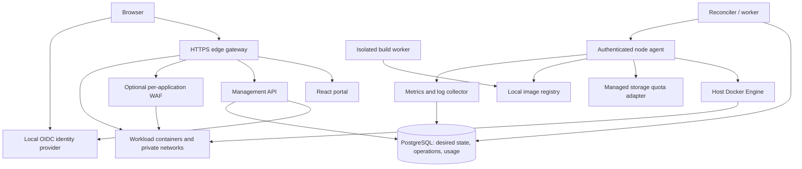

# Kzure — Docker-based on-premises cloud project plan

**Prepared:** October 26, 2026  
**Status:** Original implementation specification with a working single-host development foundation; the full product is not yet complete.

**Confirmed deployment approach:** One host first, expand to multiple hosts later.  
**Working product name:** Kzure. Use an original identity with an Azure-inspired resource model and portal experience.

## Current execution plan — October 27, 2026

**Feature review baseline: `0a10e08`.** The [current feature analysis and ordered backlog](docs/CORE_FUNCTIONALITY_GAP_PLAN.md) supersedes earlier inventories that described custom image deployment, revisions, resize and retained restore as missing. Those features are now implemented for the documented application scope; [application progress](docs/APPLICATION_PROGRESS.md) records verification. The original P0–P10 packages below remain design/acceptance references, not current completion estimates.

The main missing journey is a custom app with a stable HTTPS hostname, managed private database/storage bindings, and recovery from an actual workload backup. Existing local ports survive application recreation; retained-volume restore reuses data on the existing disk. Neither feature completes managed ingress or disaster recovery.

Managed loopback application hostnames and TLS are now implemented, with 13 ingress groups passed. See [ingress progress](docs/APPLICATION_INGRESS_PROGRESS.md) for operator steps and remaining certificate/domain/replica gates. Managed data bindings have since been added; workload backups are the next priority.

Managed PostgreSQL/Valkey/S3 application bindings are implemented, with an example HTTP application proving actual data operations through its managed HTTPS endpoint. See [binding progress](docs/APPLICATION_BINDINGS_PROGRESS.md). Credential rotation/provider upgrades remain separate gates. The next implementation work is provider-aware workload backups and restoration into fresh volumes, followed by physical storage protection.

### Execution sequence and release gates

| Milestone | Next work | Gate |
|---|---|---|
| M1 — Complete application hosting (in progress) | Operation side-effect fencing and observed firewall repair; managed hostname/TLS ingress; app/database/S3 bindings. Keep delivered image/configuration/revision/resize behavior | Stable URL and private data access survive replacement; invalid changes preserve working state; no stale operation mutation; scoped access and cost remain correct |
| M2 — Recover and operate workloads (planned, partial foundations delivered) | Provider-aware backups and volume inventory; physical disk protection; full installation recovery; static/object UI, practical networking, templates/quotas; replicas, diagnostics and editable cost analysis | Restore rows/objects/files into fresh volumes and a clean installation; deploy/manage/tear down a complete stack through supported workflows |
| M3 — Complete requested single-host catalog (planned) | Source-build PaaS and app plans, WAF, finite CPU/GPU jobs, budgets/overhead; supported Linux install/upgrade and release qualification | Real provider behavior with acceptance evidence, including WAF no-bypass and actual exclusive GPU execution; hardware-blocked gates remain explicit |
| M4 — Expand to multiple hosts (deferred) | Enrollment, placement, connectivity, storage locality/migration and fencing | Safe ownership/recovery on a second host; HA is a separate gate |

Slice 1 reliability prerequisites are now implemented in the documented single-agent scope: observed firewall repair, lease heartbeats, guarded lifecycle requests and independent maintenance. See [reliability progress](docs/RELIABILITY_PROGRESS.md) for evidence and remaining daemon/distributed limits. Continue with slices 2–3 in the [execution backlog](docs/CORE_FUNCTIONALITY_GAP_PLAN.md#next-implementation-backlog), and design backups alongside M1. Current highest-impact gaps are workload recovery, disk exhaustion protection and the wider operation/daemon recovery gates; address them before treating the installation as a dependable place for valuable data.

Portal authentication enhancements remain deferred by user instruction. Preserve existing protections. Linux workspaces/desktops remain containers sharing the host kernel; true VMs require a separate future provider. Keep single-host first, qualify Linux storage/GPU behavior on actual compatible hardware, and do not present historical test totals or screenshots as full product qualification.

The feature analysis was followed by the reliability implementation above. Its test evidence is recorded separately so the original source review is not confused with runtime qualification. See [implementation status](docs/implementation-status.md) for delivered behavior and evidence limits.

## 1. Product objective and boundaries

Build a self-hosted cloud portal where an administrator can create tenants, subscriptions, resource groups, and real resources on local hardware. A resource creation request must provision actual Docker containers, networks, managed storage, credentials, endpoints, and usage records. The product must support application hosting, object storage, managed databases and caches, WAFs, Linux workspaces, and GPU compute.

The experience should feel like operating a small cloud: browse a service catalog, pick a size, see an estimate, deploy, inspect status and logs, resize, back up, restore, and delete. All service data stays on infrastructure controlled by the operator. No Azure subscription, Azure control plane, or cloud account is required.

Platform services and workloads run in containers. The Linux host, Docker Engine, filesystem configuration, firewall, physical disks, and optional GPU driver/runtime remain host prerequisites. A Docker image cannot provide hardware that the machine does not have.

### Explicit product boundaries

- Provide Azure-like organization and workflows, not Azure API, ARM/Bicep, Azure CLI, or managed-service compatibility. Document each service's actual protocol.
- Start with one trusted organization and its internal tenants. Shared-kernel containers and application RBAC do not provide a public-cloud boundary against hostile tenants. Stronger isolation requires a later VM/microVM or separate-host offering.
- Ubuntu, Debian, Alpine, Fedora, Rocky Linux, and AlmaLinux choices are container userlands sharing the host kernel. Label them **Linux workspaces**, never virtual machines. No arbitrary kernel, nested virtualization, or systemd guarantee.
- The first release is single-host and has a host-level single point of failure. Multiple replicas on that host improve process resilience, not host availability.
- Object storage uses an S3-compatible API. An account is a Kzure management abstraction. It is not automatically an Azure Blob, File, Queue, or Table endpoint.
- GPU support starts with supported NVIDIA hardware and exclusive whole-device allocation. AMD/Intel acceleration, MIG partitions, and shared GPU scheduling are later capabilities with separate validation.
- Local cost is showback: a transparent estimate of hardware capacity consumption. It is not an Azure bill or a payment system.

## 2. Scope and release sequence

| Release | Required outcome |
|---|---|
| R0: Architecture and host proof | Prove Docker provisioning, persistent storage quota enforcement, routing, host recovery, and optional GPU discovery on the target Linux host. |
| R1: Useful MVP | Login, tenant/subscription/group hierarchy, RBAC, quotas, real resource lifecycle, generic containers, static sites, dedicated object storage accounts, basic logs/metrics, estimates, and a reproducible install. |
| R2: Complete single-host platform | PaaS application plans and runtimes, PostgreSQL, cache, WAF policies, Linux workspace catalog, batch/GPU jobs, source builds, backups, restoration, budgets, and release hardening. |
| R3: Multiple hosts | Host enrollment, placement, secure cross-host connectivity, explicit volume locality, drain/migration, fencing, and a tested recovery model. |
| Later extensions | Functions, queues, SMB file services, additional databases, advanced autoscaling, MIG, Terraform provider, HA control plane, and stronger workload isolation. |

R2 completes the requested initial product. R3 is a planned expansion, not a prerequisite for useful operation. Do not mark future catalog cards as deployable before they have working providers.

## 3. Host requirements and capacity planning

Use a supported Linux server distribution and Docker Engine with Compose v2. Keep development on Windows possible through a Linux VM or WSL2, but qualify the actual deployment on Linux. Do not equate Windows filesystem, networking, or GPU behavior with the qualified Linux target.

Planning profiles below are starting assumptions to benchmark, not measured requirements or purchasing advice:

| Profile | CPU | RAM | Storage | GPU |
|---|---:|---:|---|---|
| Small functional lab | 4 logical CPUs | 16 GiB | 100+ GiB SSD free | None |
| Broader service development | 8–16 logical CPUs | 32–64 GiB | 500+ GiB SSD free | Optional |
| GPU development | Workload-dependent | 32+ GiB | SSD with model/dataset headroom | Supported NVIDIA device with enough VRAM for the selected workload |

Start by reserving approximately 2 logical CPUs, 6 GiB RAM, and a separate storage budget for the host/control plane/build cache. Measure and revise this reservation; the small profile cannot run the entire catalog concurrently. Default CPU and RAM admission overcommit ratios to 1.0. Offer CPU overcommit later as an explicit admin setting. Do not overcommit physical storage or GPUs in the first release.

Inventory CPU architecture, logical CPU count, memory, filesystem type, free bytes/inodes, Docker capabilities, network ranges, GPU UUID/model/VRAM, and driver/runtime compatibility. Disable unsupported SKUs with a useful explanation. ARM64 images require their own build/test path; initial qualification is amd64.

**Storage gate:** Require a prepared quota-capable data filesystem for hard storage limits. The initial adapter should use XFS project quotas on operator-approved resource directories. Its host permissions, mount visibility, and accounting must be proved in R0. Never format or repartition an existing disk automatically. A developer fallback can use ordinary volumes but must visibly report `hardQuotaSupported=false` and cannot pass R2 hard-quota acceptance. XFS supports directory/project quota management; the adapter still needs end-to-end validation on the chosen host. [Red Hat XFS quota documentation](https://docs.redhat.com/en/documentation/red_hat_enterprise_linux/8/html/managing_file_systems/assembly_limiting-storage-space-usage-on-xfs-with-quotas_managing-file-systems)

## 4. Architecture



The direct edge-to-workload path exists only for resources without an attached WAF. Enabling a WAF must remove the bypass path.

### Recommended implementation stack

| Component | Default choice | Purpose |
|---|---|---|
| Portal | React + TypeScript + Vite, accessible component primitives, query caching | Resource explorer, creation wizards, status, charts, operations, and administration. |
| API / reconciler / node agent / CLI | Go; Docker Engine SDK; OpenAPI contracts | Typed host integration, long-lived operations, and small deployable binaries. |
| Platform database | PostgreSQL | Desired state, scoped identities, operations/outbox, quotas, reservations, usage ledger, audit events. |
| Identity | Keycloak with a local realm | OIDC login, MFA, local users, and service-account authentication. Application tenant membership remains in Kzure. |
| Edge | Traefik with generated file configuration | HTTPS, hostname routing, health checks, and local endpoints. No Docker socket in the edge container. |
| Registry / builds | Local OCI registry + BuildKit | Store images and construct approved application images on premises. |
| Metrics | Prometheus plus restricted node-agent metrics | CPU/RAM/filesystem/resource health; optional NVIDIA exporter after qualification. |
| Logs | Bounded Docker logs streamed through the API initially | Resource-scoped diagnostics without a mandatory large logging stack. Add Loki only when justified. |
| Deployment | Docker Compose for the platform; Docker SDK for managed resources | Reproducible bootstrap and resource lifecycle independent of Compose files. |

Keep one modular API and one worker codebase at first. Do not introduce Kubernetes, a service mesh, a separate workflow engine, or an external queue for the single-host release. PostgreSQL transactional outbox and leased operation rows are enough if retries and recovery are designed explicitly.

Keycloak provides a supported container deployment path, and Traefik can consume dynamic configuration from files. These support the selected design without requiring direct Docker access in the public-facing services. [Keycloak containers](https://www.keycloak.org/server/containers), [Traefik file provider](https://doc.traefik.io/traefik/reference/install-configuration/providers/others/file/)

### Control and data plane separation

- Browser access terminates at HTTPS; sessions use secure HTTP-only cookies and CSRF protection, or an equivalently reviewed OIDC flow. Never put management credentials in local storage by default.
- Only the narrowly exposed node agent can access the Docker socket. Socket access is host-privileged; a read-only bind mount of the socket does not make Docker API calls read-only.
- API and worker send typed operations to the agent over authenticated, encrypted communication. No tenant-supplied shell commands, arbitrary bind mounts, raw Docker JSON, or host paths.
- The node agent creates only approved objects labeled with installation, resource, tenant, generation, and operation IDs. It must never prune unrelated host containers, networks, images, or volumes.
- Keep platform databases, registry administration, identity administration, and the agent off workload networks. Expose only configured edge ports and an operator-restricted management path.
- The first host belongs to one installation; node identities and placement records exist from day one to allow later expansion.

Docker's daemon is a sensitive attack surface. These restrictions reduce exposure but do not turn shared-host containers into a hostile-tenant sandbox. [Docker Engine security](https://docs.docker.com/engine/security/)

## 5. Organization, identity, and authorization

```text
Installation
  Tenant
    Subscription
      Resource group
        Resource
          Revisions / bindings / volumes / endpoints
```

An installation administrator manages hardware, global policies, catalog entries, and recovery. A tenant contains memberships and one or more subscriptions. Subscriptions contain quotas, budget settings, and resource groups. Resource groups organize lifecycle and permissions; they are not automatically network boundaries.

Initial roles: installation administrator; tenant administrator; subscription owner; contributor; reader; cost reader. Owners assign roles; contributors manage resources but cannot elevate access. Define additional capabilities for secrets, terminal access, builds, restore, and destructive purge. A reader cannot read plaintext secrets or run a shell. Scope inheritance flows downward; no cross-tenant inheritance. Users may belong to multiple tenants and must select an active context.

Every API action validates both the caller's scoped permissions and the ownership of every referenced object. Use PostgreSQL row-level security as defense in depth with a non-owner, non-`BYPASSRLS` application role and transaction-local tenant context. Test connection-pool reuse and background jobs. System-wide metering uses a separate narrowly scoped service identity. PostgreSQL owners and privileged roles can bypass ordinary RLS, so application authorization remains essential. [PostgreSQL row security](https://www.postgresql.org/docs/current/ddl-rowsecurity.html)

Quota dimensions: provisioned CPU, RAM, GPU devices by class, persistent GiB by storage class, resource count, concurrent builds, concurrent jobs, and endpoint count. Apply subscription and tenant ceilings. Quota is an admission rule; container limits and filesystem controls are separate enforcement mechanisms.

## 6. Resource catalog and Docker image deliverables

All supported resources get a catalog schema, sizing options, lifecycle provider, pinned image recipe or pinned upstream image, readiness test, backup policy, metering map, and portal views. A logical resource may own several containers. Account for all of them.

| Resource | Local implementation | Image/build output | Required initial behaviors |
|---|---|---|---|
| Static web app | Immutable Nginx site image from approved build output or uploaded static archive | `kzure/static-web` base plus per-deployment image digest | ZIP upload, bounded extraction, index/SPA fallback setting, TLS hostname, revisions, atomic route switch, rollback. |
| Container app | User-selected approved OCI image | Imported and mirrored digest, no pointless wrapper required | Environment/secret references, port, health checks, limits, persistent volume mounts, start/stop/restart, logs, manual scale and revision rollback. |
| App service plan | Logical CPU/RAM budget for related PaaS apps | No idle placeholder container; backing apps consume plan resources | Each app declares a slice; enforce sum of slices at admission, per-app runtime caps, and plan total. Plan cap is not an extra charge. |
| PaaS web app | App packaged using a selected runtime recipe | `kzure/runtime-node`, `runtime-python`, `runtime-dotnet`, `runtime-java` | Approved runtime versions, build/start settings, health probe, secret bindings, revisions, custom domain, deployment logs. |
| Storage account | Dedicated SeaweedFS deployment per account in the initial release | `kzure/storage-seaweed` configuration wrapper | Private S3 endpoint, bucket list/create/delete, object upload/download, scoped access keys, key rotation, quota, persistence, backup/restore. |
| Managed volume | Quota-backed directory exposed as a managed volume | No always-running container; node storage adapter owns it | GiB quota, attachment validation, growth, retained/deleted state, backup integration; no arbitrary host mount paths. |
| PostgreSQL service | Dedicated PostgreSQL container and data volume per database-server resource | `kzure/postgres` with validated configuration/health behavior | Generated credentials, private endpoint, connection secret, backup/restore, readiness, supported version selection. |
| Cache service | Dedicated Valkey container | `kzure/valkey` | Auth, private endpoint, memory budget, eviction policy, optional persistence and backup. |
| WAF policy + gateway | Nginx ModSecurity + OWASP CRS protecting an app | `kzure/waf-crs` | Detection/block modes, scoped exclusions, request/body limits, event view, test requests, fail-closed when attached. |
| Linux workspace | Approved distro image with an init process and non-root user | `kzure/workspace-{ubuntu,debian,alpine,fedora,rocky,alma}` | CPU/RAM/storage sizing, persistent home, audited browser terminal, stop/start, expiry. No VM or kernel claims. |
| CPU batch job | One-shot OCI workload | Selected approved image | Command/args, timeout, bounded retries, exit status, log retention, input/output volumes, scheduled invocation. |
| GPU job | CUDA-compatible OCI workload with an exclusive GPU assignment | `kzure/gpu-cuda`, optional `kzure/gpu-pytorch` | GPU model/VRAM requirement, device UUID assignment, queue/reject policy, limits, progress/logs, result artifacts, automatic compute release. |
| GPU notebook | Authenticated notebook with CUDA support | `kzure/gpu-jupyter` | Private/authenticated access, persistent workspace, idle shutdown, explicit device reservation, secret-free URLs. |
| Local image registry | Platform registry with scoped access | Pinned registry image and Kzure configuration | Pull/push permissions, image digest inventory, safe retention, offline image import/export. |

SeaweedFS is the initial S3 storage engine candidate. Qualify the chosen version's authentication, persistence, required S3 operations, and backup procedure in R0 before committing to it. Do not claim all S3 features or Azure compatibility. [SeaweedFS upstream project](https://github.com/seaweedfs/seaweedfs)

Use the CRS project's maintained container base rather than inventing a WAF engine. Rules require tuning and do not guarantee protection against every attack or upstream network saturation. [OWASP CRS containers](https://coreruleset.org/docs/1-getting-started/1-3-using-containers/)

### Image engineering standard

1. Pin base images and catalog images by digest in `images.lock.json`; select supported versions at implementation time. No `latest` tags in release manifests.
2. Use multi-stage builds, non-root runtime users where supported, minimal packages, health checks, init/signal handling, and explicit architecture metadata.
3. Do not bake secrets into image layers. Inject short-lived build secrets and runtime secret files; redact logs. Environment injection is compatibility-only and documented as inspectable by privileged operators.
4. Produce SBOMs, vulnerability scan results, checksums, image provenance, license notices, and signatures for Kzure-built images. Validate redistribution terms for upstream software and GPU images; this plan does not grant redistribution rights.
5. Standardize labels, supported ports, writable paths, required capabilities, sizing minima, backup hooks, and readiness behavior in each image manifest.
6. Build all six workspace images from vendor-supported releases. Smoke-test startup, package-manager availability where intended, non-root shell, home persistence, signal handling, and resource limits.
7. Permit arbitrary OCI images only through an admin-governed import path. Resolve tags to digests, reject privileged configuration, validate CPU architecture, and record scan policy outcomes.

## 7. Resource API, state model, and reliable provisioning

Use immutable UUIDs internally and Azure-like external resource paths:

```text
/tenants/{tenantId}/subscriptions/{subscriptionId}/resourceGroups/{groupName}
  /providers/Kzure.Compute/containerApps/{name}
```

Every resource has a type, API version, location (`local-1` initially), SKU, tags, desired specification, observed status, generation, host placement, endpoint references, volume references, secret references, and timestamps. Keep desired state separate from observed state and from operation status.

Core tables: tenants, memberships, subscriptions, resource_groups, role_assignments, resources, resource_revisions, resource_dependencies, nodes, catalog_entries, image_digests, volumes, network_bindings, endpoints, secret_versions, operations, operation_steps, outbox, capacity_reservations, usage_intervals, rate_cards, cost_rollups, budgets, audit_events, backups, and restores.

### API contract

- `POST /api/v1/deployment-plans`: validate a template, resolve defaults and dependencies, estimate capacity/cost, return a stable preview. A preview does not reserve capacity.
- `POST /api/v1/deployments`: accept an approved template/plan with an idempotency key; revalidate capacity and return HTTP 202 plus an operation URL.
- Resource `GET`, `PATCH` with ETag/If-Match, and `DELETE`; explicit `start`, `stop`, `restart`, `resize`, `backup`, `restore`, `rotate-key` actions where supported.
- Resource-scoped metrics/logs and operations SSE endpoint; authenticated WebSocket terminal with separate permission checks and idle expiry.
- OpenAPI-generated clients for portal and CLI, pagination/filtering, stable error codes, field validation, correlation IDs, and a compatibility policy for versioned resource specs.

Provider interface: `Validate`, `Plan`, `CreateOrUpdate`, `Observe`, `Delete`, `Estimate`, plus optional `Backup`, `Restore`, `Resize`, and `RotateCredentials`. Catalog capabilities control which portal actions appear.

### Provisioning transaction and reconciler

1. Authenticate; authorize scope and all references; validate catalog policy, names, sizes, ports, secrets, dependencies, and endpoint ownership.
2. In one database transaction, lock relevant host/quota counters, reserve capacity, write desired state, operation, audit event, and outbox entry. Reject concurrent requests that exceed capacity.
3. Worker leases the operation and persists progress. Each external step has a stable identity and repeatable outcome.
4. Agent creates approved networks, quota-backed storage, secret mounts, containers, and health probes; it returns observed object IDs.
5. Publish the endpoint only after readiness. Commit observed generation and resource status. Finalize reservations and allocation intervals using actual lifecycle events.
6. On failure, retry transient steps with capped backoff. Compensate only objects owned by this operation. Preserve existing data and last healthy revision. Show a useful failure and recovery action.
7. Reconcile on events and a periodic scan. Recover after lost events, worker crashes, agent reconnect, and Docker restarts. Never infer success merely because a command returned.

Suggested resource states: Pending, Provisioning, Running, Stopped, Updating, Degraded, Failed, Deleting, Deleted. Operations separately track queued/running/succeeded/failed/cancel-requested/cancelled. A cancellation is cooperative and must report retained storage and partial effects.

Idempotency keys are scoped to caller and operation; the same key with a different body is an error. Leases have expiries and fencing/generation checks. Keep deleted-resource tombstones and retained-volume records for accounting and cleanup.

Use deletion locks for important resources. Resource-group deletion first returns a dependency-aware plan. Require explicit data purge intent; default to retain stateful volumes. Do not expose raw `docker compose down -v` as normal product teardown.

## 8. Networking, storage, builds, and secrets

### Networking and local TLS

- Use an operator-controlled local domain such as `cloud.home.arpa`, with wildcard DNS configured on the LAN resolver. Provide an exact-hosts-file option for small development setups; hosts files do not support wildcard records.
- Use a local CA with documented trust installation, or operator-supplied certificates. Public ACME is optional and requires an appropriate domain/challenge setup; it cannot be assumed for an internal name.
- Use isolated resource/service networks by default and explicit connection bindings between apps and databases/storage. Tenant/group membership alone grants no network access.
- The edge is trusted infrastructure. Generate only authorized routes and attach it to the minimum required front-end networks. Do not put all tenants' backends on one unrestricted shared bridge.
- WAF topology is edge → WAF → application. Only the WAF is reachable on that app's front-end path; the backend has no alternate published port or direct edge route.
- Route updates are validated and applied atomically. Derive upstreams from managed resource IDs, not arbitrary URLs, to prevent access to host/admin services.
- Define and test host/LAN/management blocking, DNS, and outbound package/image access. Docker bridges alone do not enforce the proposed egress policy; implement an explicitly qualified host firewall adapter and test actual packets through Docker's rules.
- Private database/cache endpoints are default. Any direct TCP publishing requires a separate operator policy, an allocated port, scoped credentials, and an audit event.

### Persistent storage

Maintain a volume registry with host, storage class, path identifier, project quota ID, requested capacity, physical usage, attachment mode, owner, and retention state. Managed data paths must be under one allowlisted root, resolved without path traversal or symlink escape. Deny host filesystem mounts supplied by tenants.

A normal Docker named volume does not by itself establish a per-resource GiB limit. Use the quota adapter for managed data; cap temporary writes with tmpfs limits or a qualified writable-layer quota. Bound Docker logs, image cache, registry storage, and build scratch independently so users cannot exhaust the host outside their volume quota. Docker documents that volumes persist independently of container lifecycles. [Docker volumes](https://docs.docker.com/engine/storage/volumes/)

For an S3 account, display logical object usage separately from physical storage consumption and metadata overhead. An advertised object allowance must leave measured overhead headroom inside the reserved physical pool. Reject storage growth that cannot fit; do not silently shrink a populated volume. Stop/delete operations distinguish compute release from retained storage.

### Application builds

First support a static archive and an existing image digest; then add source archives and explicitly selected Git repositories. Source builds execute user code. Use a separate rootless BuildKit worker where compatible, no production Docker socket, no production secrets, resource/time/disk limits, and restricted network access. Rootless builds still share a kernel; defer hostile untrusted builds to separate worker hosts.

Reject oversized archives, path traversal, symlink escapes, and archive bombs before extraction. User-controlled repository URLs need SSRF checks and must not reach control-plane/host endpoints. Provide a deliberate credential flow for private repositories and never retain credentials in source URLs or logs. Builds push a digest to the local registry, then deployments reference that digest. Runtime rollback selects a previous digest; it does not reverse database migrations. [Docker BuildKit](https://docs.docker.com/build/buildkit/)

### Secrets and backups

Encrypt secrets at rest using an installation key held outside the application database. Track key versions and rotation. Deliver short-lived or narrowly scoped secret files through the agent, ideally into protected tmpfs, and clean them up on termination. Keep the root key recoverable through an operator-controlled offline backup; losing it can make restored data unusable.

Back up platform PostgreSQL, identity configuration/database, image/catalog metadata, encryption recovery material, certificates, and workload data. Use database-consistent dump/backup procedures; a blind copy of a running database volume is not sufficient. Store copies on a separate operator-owned disk or on-prem host. A backup on the same physical disk is not host-loss protection.

Initial design target: daily backups, 24-hour RPO, and a lab restore within four hours for a documented small dataset. These are targets until demonstrated. Restore to a new resource first, validate it, and offer an endpoint switch. Test full installation recovery from a clean host, not just individual file extraction.

## 9. GPU and high-compute scheduling

Discover physical devices by stable UUID and record model, VRAM, driver/runtime, and supported image compatibility. A GPU SKU contains CPU, RAM, GPU class/count, minimum VRAM, and storage requirements. Admission uses atomic device reservations, not just a GPU count.

The default is exclusive assignment of a whole GPU. Restrict the container's visible devices to the assigned UUID. Never use `--gpus all` for user workloads. A second request for the occupied device must queue or fail with a capacity explanation. CPU/RAM limits remain separate.

Install and qualify the host GPU driver and NVIDIA Container Toolkit before enabling GPU catalog entries. Run a discovery test and a real computation test inside a container; then validate cancellation, timeout, restart, and device release. Host changes can affect GPU visibility, so include the vendor's runtime troubleshooting cases in the compatibility checks. [NVIDIA Container Toolkit installation](https://docs.nvidia.com/datacenter/cloud-native/container-toolkit/latest/install-guide.html)

Do not advertise an arbitrary GPU percentage or a hard VRAM cap on an ordinary whole-device Docker workload. MIG partitioning is a later resource type only for supported hardware, with its own inventory and reservation unit. Do not allocate both a parent GPU and its MIG children. [NVIDIA MIG guide](https://docs.nvidia.com/datacenter/tesla/mig-user-guide/latest/index.html)

CPU-oriented high-compute options expose larger CPU/RAM limits and optional CPU pinning after benchmark qualification. Job queues have concurrency limits, deadlines, fairness across subscriptions, and cancellation. GPU notebooks use idle shutdown and maximum-session policies. A model download has its own progress and disk budget; do not silently download large models during a basic deployment.

## 10. Cost and capacity model

### Four separate views

1. **Capacity:** physical total, platform reserve, admitted workload reservations, actual utilization, and remaining allocatable capacity.
2. **Deployment estimate:** projected units and cost for a proposed resource, with expected running hours and retained-storage duration.
3. **Allocated showback:** time-weighted provisioned CPU/RAM/GPU while assigned, plus provisioned persistent storage while retained. This is the primary internal cost ledger.
4. **Observed utilization:** actual CPU time, RAM usage, GPU utilization/VRAM, and physical storage use. This indicates waste and saturation; it is not added to allocated showback as another bill.

CPU is measured in logical CPU equivalents: 1 vCPU is a full logical CPU's scheduler time. A Docker CPU cap limits time, not benchmark-equivalent performance or dedicated ownership. RAM uses GiB (2^30 bytes). GPU is device-class hours, or explicitly supported MIG-profile hours later. Storage uses provisioned GiB-hours per storage class. [Docker CPU and memory constraints](https://docs.docker.com/engine/containers/resource_constraints/)

### Allocation formula

For each interval where allocation and rates are constant:

```text
hours = interval_seconds / 3600
compute_cost = hours * (vcpu * cpu_rate + ram_gib * ram_rate
                        + sum(gpu_count_by_class * gpu_rate_by_class))
storage_cost = hours * sum(provisioned_gib_by_class * storage_rate_by_class)
resource_cost = sum(compute_cost + storage_cost over all intervals)
```

Split intervals at allocation changes, stop/start, GPU attach/release, storage changes, deletion, and effective-dated rate changes. CPU/RAM charge stops only when deallocation is observed, not when the API request is accepted. GPU charge stops when device release is confirmed. Persistent storage continues while retained, including after compute stops or its parent resource is deleted. Running but idle workloads still reserve capacity and accrue allocated showback.

Use UTC timestamps, decimal arithmetic, immutable rate-card versions, deterministic unit conversion, and rounding only at the final display/export level. Estimate a standard month as 730 hours but meter actual elapsed time. Use capacity events for allocation, not sampled CPU percent. Sample utilization every 30–60 seconds and aggregate historical data. Mark unknown/gap intervals explicitly; do not silently count missing telemetry as zero or claim observed runtime during an unverified outage. Reconcile from agent/Docker timestamps and report unresolved uncertainty separately.

### Illustrative rate card

These values are invented example USD-denominated internal rates, not market prices, measured electricity expense, or Azure pricing. Operators may replace them with local currency or capacity credits.

| Meter | Example unit rate |
|---|---:|
| CPU | $0.010 per vCPU-hour |
| RAM | $0.002 per GiB-hour |
| GPU, example class | $0.500 per device-hour |
| SSD capacity | $0.000140 per GiB-hour, about $0.1022/GiB per 730-hour month |

No actual GPU model is assigned the sample rate until the operator maps a hardware class to it. VRAM is shown as a capacity attribute; do not add a second VRAM charge on top of the whole-device rate.

| Example resource | CPU | RAM GiB | GPU | Storage GiB | Compute hours | Storage hours | Estimated total |
|---|---:|---:|---:|---:|---:|---:|---:|
| Static site | 0.25 | 0.25 | 0 | 1 | 730 | 730 | $2.29 |
| Storage account | 0.5 | 1 | 0 | 100 | 730 | 730 | $15.33 |
| Web app | 1 | 2 | 0 | 10 | 730 | 730 | $11.24 |
| PostgreSQL | 1 | 2 | 0 | 20 | 730 | 730 | $12.26 |
| Dedicated WAF | 0.5 | 0.5 | 0 | 1 | 730 | 730 | $4.48 |
| GPU workspace | 8 | 32 | 1 | 100 | 120 | 730 | $87.50 |
| **Illustrative portfolio** | | | | | | | **$133.11** |

Sizes are accounting examples, not validated production minima. The GPU example is `(8×0.010 + 32×0.002 + 1×0.500)×120 + 100×0.000140×730 = 87.50`. It has 120 compute hours and 730 storage hours. The portfolio total is calculated from unrounded amounts, so adding the displayed rounded rows differs by one cent. The portfolio excludes platform overhead, backups, build jobs, extra replicas, and image storage; the portal must itemize those when present.

### Optional rates based on actual hardware expense

Provide an admin worksheet for purchase cost, depreciation months, residual value, monthly electricity, measured or estimated kWh, maintenance, storage redundancy, and expected utilization. Let the operator split the non-GPU host cost into non-overlapping CPU/RAM pools; storage and GPU purchase/depreciation go into their own pools. Shared energy/maintenance must be allocated exactly once.

```text
monthly_pool_cost = monthly_depreciation + assigned_energy + assigned_maintenance
unit_rate = monthly_pool_cost / (allocatable_units * monthly_hours * utilization_target)
```

This is a planning recovery rate, not proof of actual cost recovery. Show sensitivity at several utilization assumptions and reject zero denominators. Capacity credits can use the same formulas with no currency symbol.

Keep platform overhead visible as a separate installation cost by default. Optional overhead allocation may distribute a fixed measured pool using normalized weights that sum to 1. Never charge both the pool and its allocation in the same total. Similarly, an app-service plan summarizes child allocations and does not add a duplicate reservation charge. Shared services, if introduced later, require explicit allocation rules instead of billing every tenant for the full shared container.

Budget policies: threshold alerts and optionally reject new deployments or resizes above an estimate. Do not automatically stop databases at a budget threshold. Export cost by tenant, subscription, group, resource, type, time, and tag with historical tags/rates preserved.

## 11. Portal design and user journeys

Use a familiar cloud-console pattern with an original visual identity: tenant/subscription selector, global resource search, a persistent navigation column, resource list/detail panels, breadcrumbs, and a contextual activity pane. Design responsive layouts, keyboard navigation, readable contrast, and clear error/empty states before implementation.

Required sections: Overview; All resources; Create resource/catalog; Tenants; Subscriptions; Resource groups; Deployments; Images; Networks/endpoints; Storage; Jobs; Cost and capacity; Monitoring; Backups; Access control; Host administration.

Every resource page has Overview, Configuration, Activity, Metrics, Logs, Access, Cost, and applicable Networking, Secrets, Revisions, Backup, and Terminal tabs. Hide unsupported actions based on provider capabilities and caller permissions.

### Create resource journey

1. Choose tenant → subscription → resource group and a resource type.
2. Supply name, location, image/runtime, and size.
3. Configure persistent storage, ingress/WAF, approved connection bindings, and secrets.
4. Review exact CPU/RAM/GPU/storage requirements, remaining capacity, projected cost, retention behavior, and the concrete changes.
5. Deploy and watch real provisioning steps. Success includes a working endpoint or useful job/workspace access. Failure includes the failed step and a safe retry path.

Common deployments should take a short wizard, without requiring users to write Compose YAML. Advanced users can export/import a declarative Kzure template, with schema validation and no embedded plaintext secrets. Include a CLI using the same API. Terminal access and secret reveal must be visibly privileged actions with audit records.

## 12. Repository and build organization

```text
apps/portal/                   React portal
cmd/api/                       Management API entry point
cmd/worker/                    Durable reconciliation worker
cmd/node-agent/                Docker/storage/network host adapter
cmd/kzure/                     CLI
internal/auth/                 Authorization and scoped identity
internal/controlplane/         Resource graph and operations
internal/providers/            Concrete resource providers
internal/scheduler/            Admission and placement
internal/metering/              Usage ledger and cost computation
internal/secrets/               Encryption and distribution
api/openapi.yaml               Versioned API contract
schemas/resources/             Resource and template JSON schemas
catalog/                       Resource definitions and SKU defaults
images/                        Dockerfiles and build contexts
deploy/compose/                Platform profiles and release manifests
scripts/                       Bootstrap, doctor, build, upgrade, backup
migrations/                    Database migrations
tests/                         Provider, integration, isolation, recovery, UI
docs/adr/                      Architecture decisions
docs/runbooks/                 Operations and recovery
examples/                      Deployable templates and fixtures
```

Platform images: portal, API, worker, node agent, CLI/release tools where useful, and pinned third-party services. Expose optional profiles for builds, full monitoring, and GPU features. Compose bootstraps the control plane; normal resource changes go through the control plane.

Planned developer commands: `make dev`, `make lint`, `make test`, `make test-integration`, `make images`, `make release`. Planned operator commands: `kzure doctor`, `kzure install`, `kzure backup`, `kzure restore`, `kzure upgrade`, and `kzure template deploy`. These are interface requirements to implement, not commands that exist today.

## 13. Sequential agent implementation work packages

Each phase produces code, documentation, and the evidence named in its gate. Keep an execution log with completed issue IDs, actual test commands/results, image digests, known limitations, and the next action. Start subsequent phases only after their prerequisites pass. Estimated effort is engineering days for one experienced implementer with agent assistance, excluding hardware procurement and operator waiting time.

### P0 — Validate constraints and record architecture (3–5 days)

**Tasks:** Inventory host; record Docker, filesystem, networking, and GPU capabilities; define supported service behavior and threat model; choose exact supported dependencies; create architecture decisions; prove storage quota adapter, SeaweedFS account auth/persistence, edge routing, and GPU runtime if available. Produce capacity and image-version manifests.

**Gate:** A test workload starts through the SDK, cannot exceed its selected writable-storage quota, persists data after recreation, and is reachable over the chosen local TLS design. GPU tests pass on real hardware or GPU support remains explicitly unqualified. No user data disk is reformatted.

### P1 — Design contracts, portal flows, and bootstrap (5–8 days; depends P0)

**Tasks:** Repository scaffolding; CI; OpenAPI/resource schemas; relational model; portal wireframes; design tokens; Dockerfiles for platform code; Compose profiles; config validation; host `doctor`; local certificates; migrations; development seed fixture.

**Gate:** A clean supported host can launch a health-checked skeleton; the portal displays actual API/host status. Wireframes cover create, failure, resize, retained-data deletion, and recovery. CI builds the initial images reproducibly.

### P2 — Identity and scoped resource governance (7–12 days; depends P1)

**Tasks:** OIDC login/MFA setup; tenants, memberships, subscriptions, groups; role inheritance; RLS; service accounts; quotas; tags; audit events; tenant switcher and hierarchy screens.

**Gate:** Two test tenants cannot access each other's resources, logs, secrets, metrics, terminals, backups, or cost exports through either UI or direct API calls. Contributor cannot grant themselves owner privileges. App database role cannot bypass RLS.

### P3 — Real provisioning and generic containers (7–12 days; depends P2)

**Tasks:** Node enrollment/authentication; inventory; atomic reservations; desired/observed state; provider framework; transactional outbox; durable operations; Docker object ownership labels; container/volume/network providers; health probes; logs/metrics; start/stop/restart/resize/delete; retained-data behavior.

**Gate:** A container created in the portal runs on the host with enforced limits and real logs. Repeating the same request creates one resource. Kill the worker between steps, restart Docker, and replay requests: reconciliation completes without duplicate containers, lost volumes, or leaked capacity. Simultaneous admissions cannot exceed the configured host limit.

### P4 — Static web apps and managed ingress (7–12 days; depends P3)

**Tasks:** Static archive validation; immutable site builds; registry integration; gateway config generation; local DNS/TLS runbook; revision health checks; atomic routing; rollback; portal creation and deployment progress; basic allocation estimate.

**Gate:** Upload a sample site, visit its endpoint from a LAN client, deploy a new revision, reject an unhealthy revision, and roll back. Endpoint uniqueness and authorization are enforced. Site never gains management-network access.

### P5 — Storage accounts and MVP release (7–12 days; depends P4)

**Tasks:** Dedicated storage account provider; buckets/objects; access keys and rotation; quota-backed storage; usage visibility; storage browser; basic backup; CPU/RAM/storage showback; installation packaging and MVP documentation.

**Gate:** Upload/download via a standard S3 client, recreate the account container without losing data, reject writes at enforced capacity, rotate credentials, and restore a test backup. Demonstrate the complete R1 flow on a clean host. No account can access another account's data.

### P6 — PaaS runtimes, databases, and cache (8–14 days; depends P5)

**Tasks:** App-service plans; runtime image recipes; approved source builds; app resource slices; secret injection; private connection bindings; PostgreSQL and Valkey providers; consistent backups; revision workflow and manual replica scaling.

**Gate:** Deploy a sample application that writes to PostgreSQL, uses cache, and serves requests through TLS. Restart containers and verify data. Restore a database into a new resource. Builds cannot read production secrets or Docker API. App-plan accounting does not double count its children.

### P7 — WAF and network policy (6–10 days; depends P6)

**Tasks:** WAF policy schema; gateway provider; detect/block modes; rule tuning UI; security events with redaction; rate/body limits; trusted forwarding headers; egress controls and network-binding policy tests.

**Gate:** Normal requests succeed; agreed benign attack-test fixtures are logged/blocked; tenant-defined exceptions cannot weaken other resources. Direct backend access is denied after WAF attachment. A failed attached WAF does not create a bypass route. Workload-to-host/control-plane/LAN restrictions pass packet-level tests.

### P8 — Linux workspaces and CPU/GPU jobs (6–10 days; depends P7)

**Tasks:** Six distro images; authorized terminal; home persistence; job queue/timeouts/retries; GPU discovery and allocation; CUDA/PyTorch/notebook images; idle shutdown; result artifacts; unsupported hardware messaging.

**Gate:** Each distro image runs a real shell and retains its home directory. A CPU job completes and releases capacity. On compatible hardware, a real GPU calculation completes; a competing job cannot acquire the same device; cancellation and idle shutdown release reservations. Emulated tests alone cannot qualify GPU support.

### P9 — Cost analytics and capacity controls (6–10 days; depends P8)

**Tasks:** Complete immutable allocation ledger; effective-dated rates; timestamp/gap handling; utilization charts; forecasts and budgets; scoped cost exports; hardware expense worksheet; platform overhead visibility; garbage collection accounting; retention limits.

**Gate:** Golden cases cover fractional hours, resource resize, restart, replica count, GPU release, retained storage, rate changes, duplicate events, missing telemetry, and shared overhead. Historical totals reproduce exactly from ledger inputs. The example portfolio totals $133.11 after final rounding.

### P10 — Resilience, security, build, and R2 release (8–14 days; depends P9)

**Tasks:** Fresh-host installer; offline bundle; image scans/SBOM/signatures; recovery runbooks; upgrade/migration procedure; backup schedule and full restore drill; resource-isolation test suite; accessibility pass; bounded load tests; documentation and operator walkthrough.

**Gate:** Install from the release bundle, deploy all supported resource types, back up, restore on a clean host, and perform a supported upgrade. Validate failure cases and record measured recovery/performance. Release includes image digests, compatibility matrix, signed checksums, test evidence, and known limitations.

### R3 — Multi-host expansion (separately estimate after R2; planning allowance 4–8+ weeks)

**Tasks:** Certificate-based node enrollment and revocation; node labels/zones; scheduler placement; heartbeats; capacity reconciliation; secure cross-host routing; draining; device inventory per node; explicit data transfer or shared-storage adapter; migration operation with source fencing.

**Gate:** Stateless deployment works on a second host; an unavailable node stops receiving work; stateful workloads remain pinned unless an explicit data-safe migration succeeds. Prevent a disconnected original node from serving concurrently with a replacement before automatic failover is enabled. Test split-brain and network partitions. Multi-host scheduling alone does not make the database, edge, or storage highly available; design and qualify those separately.

### Effort interpretation

P0–P10 total **70–119 engineering days** by the ranges above, roughly **14–24 working weeks before contingency**. Allow about 20% contingency for host-specific integration and recovery hardening: approximately **4–7 months** for the complete single-host product with one implementer. R1 arrives after P5: approximately **36–61 engineering days**, before contingency. These are planning estimates, not autonomous-agent completion promises. Re-estimate after P0, P3, and the first deployment on the real host.

## 14. Verification matrix and release definition of done

| Area | Evidence required |
|---|---|
| Actual provisioning | Docker inspection shows expected containers, networks, image digests, and volumes; endpoint/job behavior is independently exercised. |
| Capacity enforcement | Deliberate CPU/RAM/disk pressure, GPU allocation conflict, and simultaneous create/resize requests respect configured limits. |
| Tenant isolation | Direct unauthorized API requests plus data-plane/network checks across two tenants; logs, metrics, cost, terminal, and backup isolation included. |
| Crash recovery | Kill API/worker/agent, interrupt deployment, restart host, and verify reconciliation and preservation of persistent data. |
| Storage safety | Full disk/inodes, quota reached, retained volumes, failed deletion, backup consistency, restoration, and storage overhead handling. |
| Network/WAF | Valid TLS, private endpoints, unreachable management services, blocked direct origin path, WAF fail-closed, DNS/config error recovery. |
| Supply chain | Locked digests, supported dependency list, SBOMs/scans, license notices, provenance, and no secrets in images or release archive. |
| Costing | Deterministic reference inputs and exact decimal results; no double counting; uncertainty surfaced; budgets cannot accidentally delete data. |
| Portal | Browser E2E for essential journeys; keyboard access; clear pending/failed/empty states; no fabricated metrics or success banners. |
| Performance | Record host specification and test at agreed loads (for example 25 idle resources and 5 concurrent deployments if capacity allows); report p50/p95 and bottlenecks. |

Planning performance targets: metadata API p95 under 500 ms on the reference host; deployment events visible within five seconds; pre-pulled lightweight stateless app ready within 60 seconds under agreed load. Exclude builds, downloads, and database initialization from that deployment target. Publish measured results and revise targets openly if hardware limits require it.

R2 is complete only when a user can install the release, create two tenants with scoped subscriptions/groups, deploy every supported catalog family, verify data persistence and isolation, inspect useful resource-based costs, and restore from backup without manual database editing. An attractive portal over mocked endpoints does not meet completion.

## 15. Release artifacts and operator handoff

- Versioned Git source and release notes.
- OCI images for platform components and supported resource recipes, with immutable digests.
- Compose manifests, environment/config schema, installation script, and host diagnostic utility.
- Optional offline image archive with checksums; runtime must not depend on external telemetry or cloud services. Internet access for initial package/image downloads is separate from steady-state operation.
- Database migrations with a compatibility/backup policy; do not promise binary rollback after an irreversible schema migration. Use expand/contract changes where possible.
- Catalog schemas, example templates, OpenAPI, CLI, and a sample two-tenant demonstration.
- Rate card, accounting examples, quota definitions, and hardware-cost configuration.
- Operator runbooks: install, identity bootstrap, certificates, networking, storage preparation, GPU setup, backup/restore, upgrade, secret recovery, and teardown/retention.
- Acceptance report with actual hardware, exact versions, passed checks, unsupported capabilities, and known issues.

## 16. Decisions to confirm during P0 without blocking this plan

Discover the actual host hardware, GPU model, existing filesystem, free capacity, local domain/DNS control, and backup destination. Confirm which workloads/users are trusted and whether external access is desired. Default to LAN-only access, private storage, strict capacity admission, retained data on deletion, manual scaling, and no cloud dependency. If the hardware cannot meet a capability, disable that capability with an explanation and continue other phases; never fake successful provisioning.

The core architectural choices above are defaults the implementation agent can follow. Changes require a short architecture decision describing the problem, tradeoffs, migration impact, and updated acceptance gate. Build and verify the product in vertical slices instead of implementing every portal screen before real resources work.

## October 27 workload recovery checkpoint

Encrypted local snapshots and new-volume restoration passed 12 integration groups for the supported PostgreSQL, Valkey, S3, plain-workspace and persistent-app providers. See [workload recovery progress](docs/WORKLOAD_RECOVERY_PROGRESS.md) for exact-image/size/interruption limits and open disaster-recovery gates. An explicit [fresh reinstall workflow](docs/FRESH_INSTALL.md) now discards installation state and regenerates credentials. Physical capacity protection and complete recovery bundles remain next. Portal authentication enhancements remain deferred.
