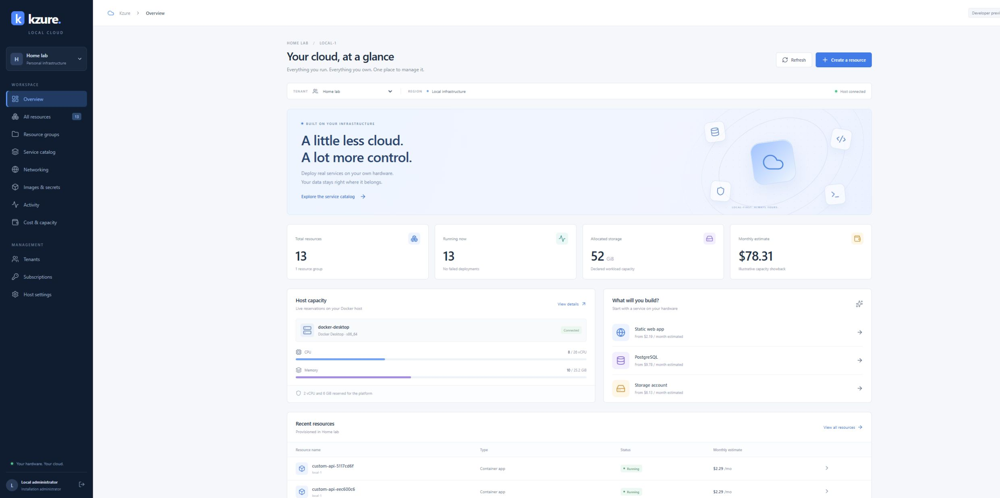
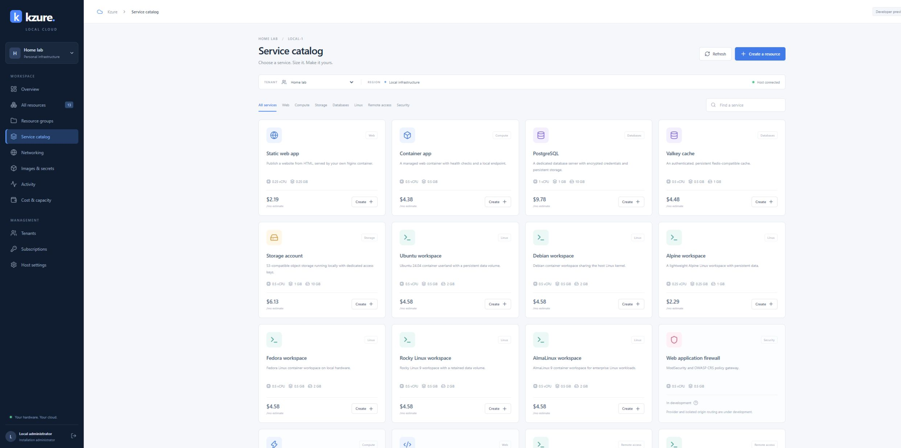
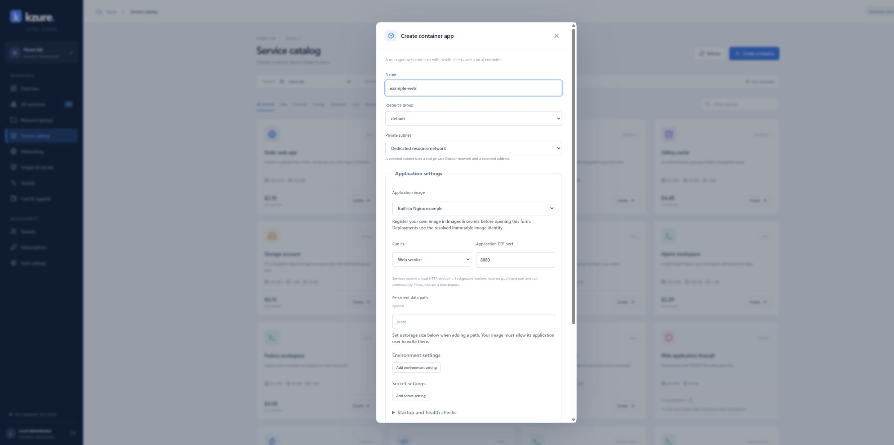
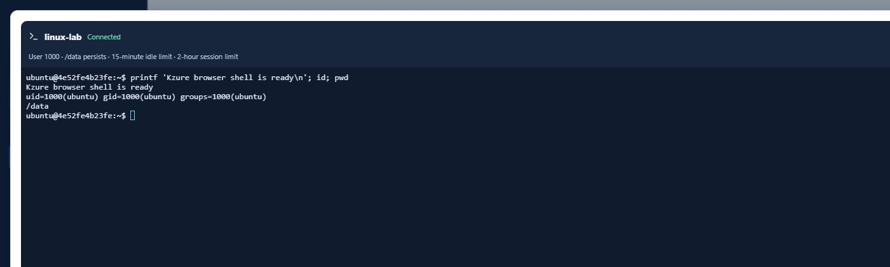
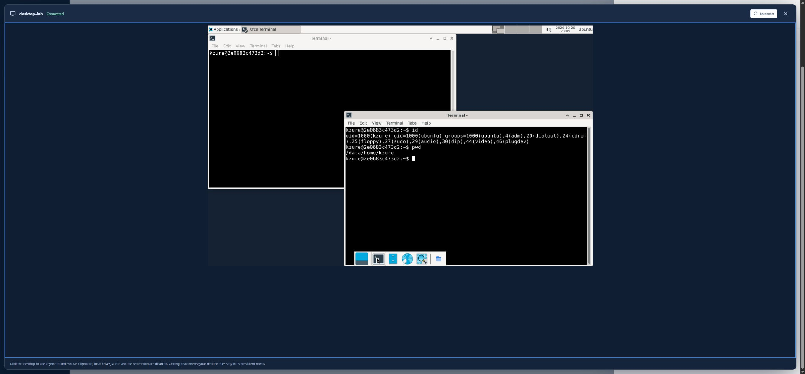

# Kzure

A local cloud portal that provisions real Docker resources on your own hardware.

**Current release: 0.1.0 development preview.** The portal, API, worker, and restricted Docker agent run as separate containers with PostgreSQL-backed state. The complete roadmap and acceptance gates are in [PROJECT_PLAN.md](PROJECT_PLAN.md). Current progress and limitations are recorded in [docs/implementation-status.md](docs/implementation-status.md).

The current [core functionality gap plan](docs/CORE_FUNCTIONALITY_GAP_PLAN.md) prioritizes custom application deployment, stable app endpoints, update/resize, retained-data recovery, workload backups and the remaining single-host service catalog. Portal authentication enhancements are deferred from this functional implementation sequence.

## Screenshots

The portal running with local demonstration resources. Click any screenshot to open it at full size.

[](docs/images/overview.jpg)

<table>
  <tr>
    <td width="50%" valign="top">
      <strong>Service catalog</strong><br>
      Browse applications, databases, storage, Linux workspaces and remote-access resources.<br><br>
      <a href="docs/images/service-catalog.jpg"></a>
    </td>
    <td width="50%" valign="top">
      <strong>Create a container app</strong><br>
      Choose an image, application settings, network, compute size and persistent storage.<br><br>
      <a href="docs/images/create-container-app.jpg"></a>
    </td>
  </tr>
  <tr>
    <td width="50%" valign="top">
      <strong>Browser shell</strong><br>
      Open an interactive terminal in a running Linux workspace.<br><br>
      <a href="docs/images/browser-shell.jpg"></a>
    </td>
    <td width="50%" valign="top">
      <strong>Browser desktop</strong><br>
      Connect to an actual container-hosted Ubuntu/Xfce desktop through the bastion.<br><br>
      <a href="docs/images/browser-desktop.jpg"></a>
    </td>
  </tr>
</table>

These are captures from working development builds. Sample resource counts, usage and interface details can change between versions; the catalog labels unfinished providers explicitly.

## Open the installed portal

Visit **http://localhost:8088**. Your installation has a randomly generated administrator password in **`.local/admin-credentials.txt`**. The default email is `admin@kzure.local`. Passwords and installation keys are excluded from Git. The first tenant is **Home lab**, containing a **Development** subscription and a **default** resource group.

The portal can create tenants, subscriptions, resource groups, and supported resources; show deployment activity and container logs/metrics; stop/start/restart resources; reveal service credentials to owners; retain or explicitly purge persistent data; and show illustrative allocation costs with CSV export.

## Install / rebuild

Prerequisites: Docker Engine with Compose and Linux containers, Node.js 24+, sufficient free disk space, and access to the pinned image/package registries for initial builds. Go compiles inside Docker; installing Go on Windows is unnecessary.

Windows PowerShell:

```powershell
./scripts/start.ps1
```

Linux:

```sh
sh scripts/start.sh
```

The scripts generate installation-specific configuration, build the catalog images, lock their image identities, build the platform, and start health-checked services. Re-running preserves the existing configuration and data. Images are built from pinned bases. The first build downloads several Linux distributions and may take several minutes.

For an application-only rebuild after source changes:

```sh
docker compose build
docker compose up -d --wait
```

The development portal and service endpoints bind only to the local machine. The portal uses `localhost`; workload endpoints use `127.0.0.1` on allocated ports. This keeps portal session cookies off workload hosts. Do not expose this development preview publicly.

## Available resource types

| Resource | Current behavior |
|---|---|
| Static web app | Actual custom Nginx image; built-in welcome site or a single uploaded/pasted HTML page; Docker health check; local HTTP endpoint. |
| Container app | Register your own local/public Linux image, deploy an HTTP service or background worker, configure environment/secret references, arguments, health checks and one persistent mount. Includes stable local port, CPU/RAM resize, revisions and rollback. |
| PostgreSQL | Dedicated PostgreSQL 18 instance, encrypted generated password, persistent volume, local authenticated TCP endpoint. |
| Valkey | Dedicated authenticated cache, persistent append-only data, memory policy sized below its container limit. |
| Storage account | Dedicated custom SeaweedFS image with local S3 endpoint, generated keys, authenticated bucket/object operations, persistent metadata/data, one-volume-at-a-time growth. |
| Linux workspaces | Custom Ubuntu 24.04, Debian 13, Alpine 3.23, Fedora 43, Rocky Linux 9, and AlmaLinux 9 images; UID 1000; persistent writable `/data`; shared host kernel. |
| SSH workspaces | Six distro variants with private SSH, Ed25519 keys, stable host identity and persistent `/data/home/kzure`. |
| Bastion gateway | Restricted SSH/RDP forwarding to explicitly assigned local resources; browser desktop transport included. |
| Ubuntu desktop | Actual Xfce desktop with private xrdp, retained certificate and browser keyboard/mouse access. |

WAF, source-build PaaS and GPU entries remain unavailable until their providers/qualification are complete. Finite jobs, private-registry sign-in, image archive import, cross-provider resize, full application/data bindings, application domains/TLS, hard disk quotas and workload backup/restore remain on the roadmap. Container-app image/configuration revisions, CPU/RAM resize and existing retained-data restore are now available.

Browser shell, native SSH, restricted bastions, browser desktop, private subnets, service connectors and associated IPv4 security groups are implemented for this single-host development preview. Follow [the implementation progress log](docs/REMOTE_ACCESS_PROGRESS.md) for evidence and remaining qualification gates. Workspaces and desktops are containers sharing the host kernel; they are not hardware-isolated VMs.

## Open a workspace shell

Open **All resources**, select a running Linux workspace, then choose **Shell**. It opens an interactive terminal as the workspace user in `/data`. Use the toolbar to reconnect, disconnect or expand the terminal. Reconnecting starts a new shell. Workspace files under `/data` survive container recreation.

Installation administrators and tenant owners can connect. A tenant owner can expand **Manage member shell access**, select a contributor, and grant or revoke access to that workspace. Readers cannot use interactive shells. Recent sessions show connection activity and let authorized users end sessions. Revocation, logout and workspace stop close active connections after the next five-second authorization check.

The localhost development defaults are two shell sessions per resource, five per user, a 15-minute input idle timeout and a two-hour maximum duration. The platform audits connections without storing shell input/output.

## Deploy your own application

Open **Images & secrets** and register an image for the active tenant. Build it locally first, or select the public-registry pull option. Kzure checks the host architecture, records the immutable image identity and keeps a local retained tag for recovery. Save workload secret values there if needed; ordinary settings belong in the environment section of the deployment form.

Choose **Create a resource → Container app**, select the image, HTTP service or continuous worker mode, application TCP port, settings and optional managed data path/storage size. Use the resource's **Configuration** tab for CPU/RAM resize, image/settings updates and revision rollback. Updates briefly replace compute and attempt to restore the previous working configuration on readiness failure. Add a valid health-check command or use an image with a working built-in check. A process-only check cannot prove application behavior.

The included example can be built with `docker build -t kzure/demo-app:0.1.0 images/application-demo`; it uses port `3000`, persistent path `/data`, and optional `GREETING`/`APP_TOKEN` environment settings. **Restore retained resource** reconnects retained data to the same resource. Missing volumes are never replaced with empty data during restore. This is separate from the still-planned workload backup/restore workflow.

See [application progress and limitations](docs/APPLICATION_PROGRESS.md). Private registry sign-in, finite jobs, multiple data mounts, storage/subnet migration, general app hostname/TLS ingress and zero-downtime rollouts remain planned.

## SSH, desktop and networking

Create a private virtual network and subnet in **Networking**, then deploy an SSH workspace or Ubuntu desktop into that subnet. Deploy a **Bastion gateway**. Select it and use **Connect** to assign allowed targets. Register your Ed25519 public key, bind it to an SSH workspace, and download the generated SSH configuration. Keep your private key on your client. Verify the workspace and bastion fingerprints shown in the portal before connecting. The gateway accepts the account email; the target workspace login is `kzure`. The generated configuration supplies the correct gateway, target alias and local port.

For Ubuntu desktop, assign it to the bastion, open the desktop's **Connect** tab and choose **Open browser desktop**. Owners and installation administrators can connect. Native RDP uses the displayed SSH tunnel instructions and an RDP client connected to the forwarded local port. Browser desktop credentials stay in the control plane; clipboard, file, drive and audio redirection are disabled.

In **Networking → Security rules**, create rules and associate a group with a subnet. Associated subnets use IPv4 default deny; lower priority numbers match first. Platform host, management and protected tenant boundaries precede tenant rules. Explicit service connectors add a named route between two resources; credentials are still required. The UI reports policy application state. Physical LAN and dedicated Linux qualification remain open. See [the architecture decision](docs/adr/0003-remote-access-and-network-policy.md).

## Optional local HTTPS

After building the platform, generate installation-private certificates and enable the loopback TLS gateway:

```sh
node scripts/configure-https.mjs
docker compose -f compose.yaml -f compose.https.yaml up -d --wait
node scripts/test-https.mjs
```

The HTTPS endpoint is `https://localhost:8443`. Certificates and private keys stay under ignored `.local/tls`. The test verifies the generated CA and hostname; it does not disable certificate verification. Browser trust is a separate operator decision: inspect the generated CA and install its public certificate through your normal trust process if desired. No trust store is changed automatically. Default `http://localhost:8088` remains available. LAN/public publication is a separate release gate.

If the administrator password stops working, run `node scripts/reset-admin.mjs` on this Docker host. The script resets the existing administrator, revokes prior sessions and saves the new password privately in `.local/admin-credentials.txt`.

Verify the terminal against the running development installation:

```sh
npm ci
npm run test:terminal
```

This uses disposable distro workspaces and scoped test users, writes a private report under `.local/terminal-report.json`, and restarts the node agent to verify recovery. The agent restart disconnects any active browser shells; reconnect afterward. Existing workspace data is preserved.

## Resource lifecycle and data

Create resource requests are transactional and require an idempotency key. CPU/RAM admission checks both host headroom and subscription quotas while holding a PostgreSQL advisory transaction lock. A durable worker processes queued operations and replays abandoned leases after expiry. A periodic reconciler detects missing/stopped managed containers and queues recovery for resources whose desired state is Running.

The agent only manages objects labeled with this installation and resource identity. A resource uses its dedicated Docker network or the selected private subnet. Only the agent has the Docker socket. Platform databases and the agent use a private management network; the portal and optional TLS gateway connect through the ingress path.

**Stop:** release compute after the stop is observed; keep persistent data.  
**Delete:** remove compute/network; keep stateful data in the Retained state.  
**Purge:** explicitly remove the owned data volume and stop storage showback; owner/admin permission required.

Keep `.env`, especially `KZURE_ENCRYPTION_KEY`, together with a securely stored database backup. Losing this key prevents decryption of service credentials. Changing `KZURE_ADMIN_PASSWORD` in `.env` after initialization does not reset the database account password.

Ordinary Docker volumes have no qualified per-resource GiB enforcement in this preview. Storage sizes are declared/accounted capacity and subscription admission limits. The portal reports this capability honestly. This does not yet satisfy the plan's hard storage quota gate. Docker networks also have not yet passed the plan's complete host/LAN egress isolation gate.

## Cost model

The current development rate card is CPU `$0.010/vCPU-hour`, RAM `$0.002/GiB-hour`, and storage `$0.000140/GiB-hour`. Allocation intervals are recorded in PostgreSQL using numeric columns and elapsed UTC time. Stopped/retained resources continue to show storage allocation; compute stops accruing after confirmed deallocation. The UI separates live utilization from allocation costs.

These are invented showback rates, not Azure prices or measured energy costs. Effective-dated editable rate cards, GPU meters, uncertainty handling across outages, platform overhead distribution, and budgets are planned. See [cost-model.example.json](cost-model.example.json) for the intended complete model.

## Verification

```sh
node scripts/smoke.mjs
```

This is an integration test against the running local development installation. It signs in using the generated local credentials, deploys real resources, tests S3 round trips and anonymous rejection, writes to PostgreSQL, authenticates to Valkey, verifies data retention and container recreation, tests tenant boundaries, rejects excess CPU admission, reads real logs/metrics, and tests recovery of a queued deployment while the worker is stopped. It creates a separate isolation-test tenant/user and removes only its explicitly disposable test resources. The five named demonstration services remain running. Results are written to `.local/smoke-report.json` without service passwords.

Run this against a development installation: it briefly stops/restarts the worker and recreates the demonstration Linux workspace container while keeping its volume.

Backend checks without installing Go on Windows:

```powershell
docker run --rm --mount "type=bind,source=$PWD,target=/src" -w /src golang:1.26-alpine sh -c 'go test ./... && go vet ./...'
```

Portal checks:

```sh
cd apps/portal
npm ci
npm run build
```

## Development and operations

The portal's development server proxies `/api` to `http://localhost:8090`; the default Compose stack does not publish the API. Use the containerized portal for normal operation, or deliberately add a localhost API port for frontend development. Do not publish the node agent.

Useful commands:

```sh
docker compose ps
docker compose logs --tail 100 api worker agent
docker compose stop
docker compose up -d --wait
```

`docker compose stop` stops the platform services; separately managed workload containers keep running. Stop workloads in the portal if you intend to release their compute. Do not use volume-removal commands as a normal shutdown procedure.

Create and verify a **platform metadata** backup:

```sh
node scripts/backup.mjs --verify
```

This writes a private PostgreSQL dump under `.local/backups/` and restores it to a temporary verification database without replacing the live database. It includes user records, encrypted credentials, operations, and allocation metadata. **It excludes workload volumes, images, and the `.env` encryption/recovery keys**; preserve those separately. This is a metadata restore check, not a completed whole-host disaster-recovery procedure.

Record a development release's local image identities:

```sh
node scripts/release.mjs
```

Add `--images` to export a Docker image archive for offline transfer. Release manifests go under `.local/releases/0.1.0-dev/`. Configuration and data are separate from image archives. The current API reference is [api/openapi.json](api/openapi.json); regenerate it with `node scripts/openapi.mjs` when endpoints change.

Architecture decisions are in [docs/adr](docs/adr). The implementation is a foundation for the planned platform and has not yet passed production, hostile-tenant, full disaster-recovery, or multi-host qualification.
