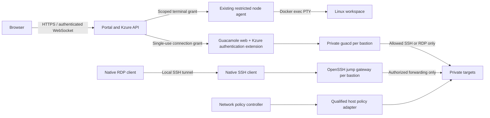

# Kzure browser shell, bastion, and networking project plan

Date: October 26, 2026. Historical design baseline. Implementation now covers browser shell, SSH/bastion, desktop and single-host IPv4 policy; see [current progress](REMOTE_ACCESS_PROGRESS.md).

This plan extends the existing 0.1.0 development platform. Deliver one host first, with stable node/resource identities that allow additional hosts later. The current development installation is Docker Desktop on Windows; qualify host firewall enforcement separately on the supported Linux server. Estimates below are engineering effort, not promises of agent elapsed time.

## 1. Access at the start of this plan

The current Linux workspaces are containers sharing the Docker host kernel. Their images do not install an SSH server, desktop environment, or RDP server. The portal has logs but no interactive terminal. Existing volumes persist `/data`; changes elsewhere in the container may disappear when it is recreated.

For the existing `linux-lab` resource, run this in PowerShell on the Docker host:

```powershell
docker exec -it --user 1000:1000 --workdir /data <workspace-container-name> /bin/sh
```

Use `exit` to leave the shell. Replace the placeholder with the running workspace's actual container name. List managed containers with:

```powershell
docker ps --filter "label=io.kzure.resource" --format "table {{.Names}}\t{{.Image}}\t{{.Status}}"
```

Docker Desktop's container Exec view is another local operator option. Docker access grants broader host authority than Kzure tenant permissions, so these are operator workflows. The planned web shell will enforce Kzure permissions. [Docker exec reference](https://docs.docker.com/reference/cli/docker/container/exec/)

## 2. Deliverable experience

1. Select a running workspace and choose **Connect → Browser shell**. A terminal opens in the resource page with its name, current identity, connection state, resize, paste, fullscreen, and disconnect controls.
2. Choose **Connect → SSH** to register a public key and copy a generated connection command. Keep private keys on the user's device. Connections go through the selected bastion to the private workspace.
3. Create an **Ubuntu desktop** resource, select **Connect → Browser desktop**, and use a real Linux desktop over RDP inside the portal.
4. Choose **Connect → Native RDP** to get an SSH tunnel command and an RDP profile for the local tunnel endpoint. A native RDP client does not connect directly to Guacamole.
5. Create a **Bastion** resource within a subscription/resource group, attach it to an authorized virtual network, select allowed targets, set session limits, and view active sessions.
6. Use **Networking** to create virtual networks, subnets, network interfaces, private DNS records, network security groups, and explicit service connections. View effective rules and actual connection diagnostics.
7. From another device on the LAN, access the HTTPS portal and the configured bastion SSH endpoint. Internet exposure, VPN provisioning, multi-host overlays, and true VM provisioning are later scope.

Do not label Linux containers as VMs. Windows RDP targets may later be registered as external machines; this release does not create Windows VMs in Linux containers. A bastion transports a connection; the destination still requires a working SSH or RDP service.

## 3. Architecture and implementation choices



Browser shell uses xterm.js with the existing Go API and agent. It needs no SSH server or exposed workspace port. Add streaming Docker exec handling: the current JSON request helper cannot carry an interactive upgraded connection. The agent resolves resource ownership and the actual container generation before every session.

Browser desktop and optional browser SSH use Apache Guacamole. Package a pinned Guacamole web image with a Kzure authentication extension and a separately pinned guacd image. Model these plus the native SSH gateway as one managed Bastion resource. Guacamole provides browser SSH/RDP transport; its private guacd process does not authenticate users and must never be published to clients or reachable from target workloads. [Guacamole Docker architecture](https://guacamole.apache.org/doc/gug/guacamole-docker.html)

The extension exchanges a short-lived Kzure grant over an authenticated backchannel for exactly one permitted connection. It must not give the user an arbitrary hostname field or Guacamole administrator access. Use the documented extension mechanism and version-lock the integration. [Guacamole custom authentication](https://guacamole.apache.org/doc/gug/custom-auth.html)

Native access uses a dedicated OpenSSH gateway image. It provides restricted forwarding, not an interactive shared jump-box shell. Generate per-user/per-target `PermitOpen` policy, disable agent forwarding, X11 forwarding, remote forwarding, tun devices, and unrestricted dynamic forwarding. Allow only local/direct TCP forwarding to approved target ports. Keep target login authorization separate from gateway authorization. [OpenSSH configuration](https://man.openbsd.org/sshd_config)

Use public keys first; an installation SSH certificate authority is deferred. Track connections so revocation closes existing forwarding sessions as well as preventing new authentication. Removing a key alone does not terminate an established SSH session.

## 4. Browser-shell specification

### API and authorization

- Add explicit capabilities: `workspace.shell.connect`, `workspace.ssh.connect`, `desktop.connect`, `bastion.manage`, `session.terminate`, `network.manage`, and `keys.manageSelf`. Readers receive no interactive access. Contributors require an explicit scoped connect grant; owners can assign it.
- `POST /api/resources/{id}/terminal-sessions` validates tenant, permissions, resource type, Running state, node availability, and session quota. Return a session ID and a single-use connection ticket valid for 30 seconds.
- `GET /api/terminal-sessions/{id}/stream` upgrades an authenticated same-origin WebSocket. Validate Origin and the active session cookie, then consume the ticket in the first WebSocket message within five seconds. Never put access tickets in query strings or logs.
- `DELETE /api/terminal-sessions/{id}` disconnects the session. Add scoped list/terminate endpoints for operators and resource owners.
- Bind grants to user, tenant, resource, container ID/generation, protocol, permitted Unix user, expiry, and nonce. Never accept a raw Docker container ID or arbitrary Docker API path from the browser.
- Recheck active authorization at least every 15 seconds and on logout, role change, resource stop/delete, or key revocation. Target termination within 15 seconds; deny new connections immediately.

### Session behavior

- Start `/bin/bash` when supported, otherwise `/bin/sh`, as UID/GID 1000, in `/data` for existing images and the persistent home for upgraded images. No root selector or automatic sudo.
- Carry bounded input/output/resize frames; support UTF-8, Ctrl-C, terminal dimensions, exit code, and backpressure. Do not interpret shell text as host commands.
- Default limits: two sessions per resource, five per user, 15-minute idle timeout, two-hour maximum duration; configurable by owner within installation ceilings. Input resets idle time; constant output must not keep an abandoned session alive forever.
- Disconnect should clean up the foreground shell process group through a tested session supervisor. Docker exec has no simple standalone kill endpoint: prove cancellation without stopping the whole workspace or killing unrelated sessions. Deliberate background jobs remain workspace-owned and count toward its CPU/RAM limits.
- Reconnect creates a new session initially. Persistent tmux-style sessions are a later explicit capability, not silently orphaned shells.
- Record connection metadata and termination reason. Do not record terminal keystrokes or passwords by default. Optional session recordings require an explicit policy, visible notice, encryption, retention, and restricted playback permission.
- Render output through xterm.js, never HTML injection; disable automatic clipboard writes and unsafe terminal hyperlink actions. Bundle assets locally and apply a restrictive content-security policy. [xterm.js security guidance](https://xtermjs.org/docs/guides/security/)

### Acceptance gate

Run real interactive sessions in all six distro images; validate resize, Unicode, Ctrl-C, large output, disconnect cleanup, expired/replayed tickets, wrong Origin, logout, role revocation, stopped resources, and agent restart. A user in tenant A must fail direct API/WebSocket access to tenant B. Reading logs must not imply terminal permission.

## 5. Images and target services

| Image / catalog item | Contents and responsibilities | Initial resource envelope |
|---|---|---|
| Existing six workspace images, versioned upgrade | Named non-root user, usable shell, persistent home under `/data/home/kzure`, terminal supervisor; retain existing `/data` content | Existing workspace sizes |
| Six optional workspace SSH variants | Supported distro OpenSSH server, injected public-key files, persistent per-resource host keys, private SSH port; no baked credentials | Same baseline; measure overhead |
| `kzure/bastion-ssh` | OpenSSH jump gateway, restricted forwarding, managed authorized keys and target policy, connection lifecycle integration | 0.25 vCPU / 0.25 GiB initial hypothesis |
| `kzure/bastion-web` | Guacamole web application plus Kzure authentication extension | 0.5 vCPU / 0.75 GiB initial hypothesis |
| `kzure/bastion-guacd` | Pinned upstream protocol proxy, isolated per bastion | 0.25 vCPU / 0.5 GiB initial hypothesis |
| `kzure/desktop-ubuntu` | Ubuntu + Xfce + xrdp/xorgxrdp, non-root desktop sessions, persistent home, private RDP service | 2 vCPU / 4 GiB / 20 GiB declared storage |
| `kzure/network-dns` | Scoped resolver/records and controlled upstream forwarding | Shared overhead, measured before release |

The default bastion envelope totals 1 vCPU / 1.5 GiB plus 1 GiB declared persistent state; tune after concurrency measurement. Expose supported session capacity based on load tests, not CPU labels alone. Build Ubuntu desktop first; other desktop distributions follow only after separate qualification.

xrdp supplies an RDP server for a Linux desktop. It supports clients including Windows Remote Desktop; the image must still prove desktop startup, persistence, and privilege requirements. [xrdp project](https://github.com/neutrinolabs/xrdp)

SSH and desktop service masters may require narrowly documented root startup/PAM privileges even though user sessions are non-root. Determine minimum capabilities in a build spike; do not solve failures using privileged containers, host PID/network namespaces, host filesystem mounts, or the Docker socket. If a supported configuration cannot be achieved, mark that image unavailable and document the blocking requirement.

For SSH, generate host keys once per resource, persist separately from the disposable image, show fingerprints, and rotate explicitly. Public-key login only by default; no root login. Model immutable image rebuilds for additional software instead of recommending package installation in disposable layers. For RDP, generate a per-resource credential, store it encrypted, deliver only to the gateway/authorized client, and rotate it. Clipboard, drive mapping, uploads, and downloads default off and require explicit policy.

## 6. Bastion connection workflows

**Browser:** user selects an authorized target → API checks connect permission and network path → creates expiring grant → Guacamole extension resolves target and credentials server-side → private guacd connects → session appears in Active sessions. Browser never receives reusable backend SSH keys/passwords. Pin target SSH host keys and validate RDP certificates against configured trust; do not permanently accept all certificates.

**Native SSH:** user registers a public key → owner grants target access → gateway reconciles per-user permitted destinations → portal generates an SSH configuration with gateway address, gateway user, target address/user, and host fingerprints. Standard ProxyJump reaches the workspace private SSH port. The client authenticates to both hops; agent forwarding is unnecessary.

**Native RDP:** portal generates a command in the following form after provisioning; these placeholders are not usable against today's installation:

```sh
ssh -N -L 127.0.0.1:13389:<authorized-private-target>:3389 -p <bastion-port> <user>@<bastion-host>
```

The client then connects to `127.0.0.1:13389`. Generate a connection profile without embedded passwords. Forwarding policy must permit only that user's target and port. Guacamole is not a native Microsoft RD Gateway; a true RD Gateway-compatible endpoint is separately scoped future work.

**LAN publishing:** provision trusted HTTPS with administrator-configured DNS/certificates, choose the host bind address explicitly, restrict source CIDRs, and publish only portal HTTPS and the selected bastion SSH port. Loopback remains the development default. Add MFA/step-up authentication and qualified tenant isolation before advertising remote multi-user readiness. Do not change the current localhost binding merely by creating the plan.

## 7. Networking product and enforcement

### Resource model

| Resource | Required behavior |
|---|---|
| Virtual network | Tenant/subscription-owned address space, node placement and capabilities; no automatic reachability to other tenants |
| Subnet | Non-overlapping prefix within its virtual network; attachment and security policy association |
| Network interface | Stable resource reference, private IP reservation, DNS name, effective policy and observed attachment |
| Network security group | Priority-ordered inbound/outbound allow/deny rules for source/destination CIDR or resource group, protocol and ports; first match wins, final deny |
| Service connection | Directional authorization from a source resource to an exact destination service/port, compiled into effective rules |
| Private DNS zone | Records scoped to the virtual network; lifecycle updates on recreation and attachment changes |
| Published endpoint | Explicit host address/port, backend, protocol, source CIDRs, certificate where relevant, and lifecycle ownership |
| Bastion attachment | Explicit eligible targets and allowed protocols; does not grant unrestricted access to its whole tenant |

Resource groups remain organizational, not implicit network trust. Reject address ranges overlapping the host, LAN/VPN, Docker pools, or another local virtual network. Initial release disallows overlapping tenant CIDRs; support IPv4 first, and disable or explicitly deny IPv6 paths until separately qualified.

### Delivery modes

**Docker Desktop development mode:** retain per-resource bridges; implement approved TCP service connectors/proxies and DNS aliases. A service connection authorizes that proxy route but does not prove all other traffic is blocked. Show `Limited networking` and withhold full NSG/routed-subnet claims until packet tests demonstrate them. Do not manipulate Windows firewall rules while pretending they are Linux Docker bridge policy.

**Qualified Linux mode:** expose the full VNet/subnet/IPAM/NSG experience only after a packet-filtering proof. Start with per-workload bridge isolation and a host routing/policy adapter that maps logical addresses to real endpoints. Design logical subnet allocation and physical bridge addressing explicitly in the spike; a one-bridge-per-subnet alternative is acceptable only if same-bridge lateral filtering is proven. Resource-level policy must cover traffic that never passes the usual host forwarding chain.

The network policy adapter is a separate, administrator-installed trusted component. A containerized deployment may need host network namespace access and narrowly scoped NET_ADMIN privileges. Keep it inaccessible to tenants and independent from ordinary workload configuration. Pin a supported Docker/firewall backend and use backend-specific owned chains/hooks. Do not edit Docker-owned rules, flush the host ruleset, or assume host firewall INPUT rules protect published ports. [Docker firewall behavior](https://docs.docker.com/engine/network/packet-filtering-firewalls/)

### Enforcement rules and lifecycle

- Default deny new east-west and inbound connections. Allow established return traffic. Egress to DNS, approved repositories, internet, or LAN is explicit policy. Existing legacy resources retain their documented current behavior until migrated.
- Protect host gateways, management addresses, agent ports, cloud-style metadata/link-local endpoints, and other tenants regardless of user NSG rules. User allow rules cannot override platform-deny destinations.
- Test direct container IPs, published ports, host-gateway aliases, same-subnet traffic, IPv6, UDP DNS, and multihomed paths. A direct endpoint must not bypass a protected bastion or WAF path.
- Use scoped DNS forwarding and disable unapproved resolvers in enforced mode. Resolve allowed resource destinations from controlled metadata; arbitrary DNS names must not enable rebinding to management/LAN targets.
- Apply complete versioned policy generations atomically where supported. Persist desired and observed revisions. On apply failure retain the last known safe generation, block activation of new attachments, and show Degraded; never report success for unapplied rules.
- On rule revocation close affected active flows where the backend supports it; otherwise report the limitation and block release of the required revocation capability. Test connection tracking behavior explicitly.
- Gateway control traffic uses a dedicated backchannel with authenticated, scoped messages. Target-side interfaces must not expose guacd, administration listeners, or the platform network. A shared gateway must not become an uncontrolled router between tenants.
- Reconcile only owned networks/rules/endpoints. Deletion is dependency-aware; do not remove a subnet or bastion with active dependents without an explicit disconnect workflow.
- Flow metadata includes source/destination/port/action/rule ID and counters, with retention limits. Payload capture is outside default scope. UI diagnostics distinguish policy simulation from a real live probe.

Defer multi-host overlays, VNet peering, VPN gateways, arbitrary route tables, BGP, macvlan/physical NIC passthrough, and network HA. Preserve `node_id`, attachment revisions and backend capability fields now so those features can extend the APIs later.

## 8. Schema, API, and code work packages

Add versioned migrations for `access_grants`, `ssh_public_keys`, `remote_sessions`, `bastion_targets`, `virtual_networks`, `subnets`, `ip_allocations`, `network_interfaces`, `network_security_groups`, `network_rules`, `service_connections`, `dns_records`, `published_endpoints`, and `network_policy_revisions`. Include tenant/subscription/resource identity, node ID, desired generation, observed generation, lifecycle state, and audit links where applicable.

Reuse the existing `resources`, operation queue, encrypted secrets and allocation ledger. Use composite foreign keys or equivalent checks to prevent cross-tenant references; add restricted database roles/RLS as part of remote multi-user hardening. Admission must transactionally reserve IPs, host ports, compute, storage declarations and session slots; retry must not duplicate reservations.

Add scoped REST endpoints for network CRUD, effective policy, connection checks, bastion targets, SSH keys, remote-session creation/list/termination, and connect command/profile generation. Resource creation accepts structured network attachment and access-profile fields, not arbitrary Docker settings. Update OpenAPI and client types together. Return asynchronous operation IDs for infrastructure changes.

Suggested source layout:

```text
internal/platform/terminal.go         # API grants, streaming, lifecycle
internal/platform/agent_exec.go       # owned-container PTY bridge
internal/platform/access.go           # keys, connect permissions, sessions
internal/platform/network*.go         # IPAM, policy, reconciliation
apps/portal/src/features/connect/     # shell, desktop, native instructions
apps/portal/src/features/networking/  # VNets, rules, endpoints, diagnostics
images/bastion-ssh/
images/bastion-web/                   # extension source + image
images/bastion-guacd/
images/desktop-ubuntu/
images/network-dns/
docs/adr/                            # access and networking decisions
scripts/test-remote-access.*
scripts/test-network-isolation.*
```

Keep builds pinned to tested supported versions/digests, with SBOMs, vulnerability review, license notices and reproducible image manifests. Reuse the existing installer and release exporter; do not introduce a second independent orchestration system.

## 9. Implementation sequence and acceptance gates

| Phase / issue | Work and dependency | Concrete completion gate | Effort |
|---|---|---|---|
| RA-01 Design and capability proofs | Inventory current code, supported Linux host and Desktop behavior; schema/API design; PTY, xrdp privilege and firewall spikes | ADRs, packet-path diagram, tested feasibility; unsupported modes documented | 2–3 days |
| RA-02 Browser shell | RA-01; scoped grants, streaming agent, xterm.js, session lifecycle and audit | Real six-distro interactive shell tests plus negative permissions and disconnect cleanup | 3–5 days |
| RA-03 Workspace access images | RA-01; persistent home, SSH variants, key/host-key management | Real SSH login, wrong-key denial, stable fingerprints and data through recreation; minimum privileges proven | 3–5 days |
| RA-04 Networking foundation | RA-01; IPAM, attachments, DNS, service connections, dependency handling; Desktop limited mode | Private app-to-database path works only via its configured connection where enforcement is claimed; no duplicate addresses under concurrency | 5–8 days |
| RA-05 Native bastion | RA-03/04; resource lifecycle, target ACLs, jump gateway, generated commands, session tracking | Two users reach only their targets; SSH and RDP tunnel forwarding work; revocation closes sessions | 4–6 days |
| RA-06 Browser desktop | RA-03/04; Ubuntu desktop image, Guacamole integration, scoped tickets and certificate validation | Browser desktop survives resource restart with retained files; unauthorized targets/ticket replay fail | 5–8 days |
| RA-07 Enforced networking | RA-04; Linux policy adapter, NSGs, egress restrictions, live diagnostics, migration tooling | Cross-tenant/same-subnet/host/LAN/IPv6 bypass matrix fails closed, including restart and policy rollback cases | 6–10 days |
| RA-08 Remote release qualification | RA-02 through07; LAN TLS, step-up auth, restricted DB roles/RLS, quotas, backup/upgrade, scans and docs | Fresh Linux install, second-device SSH/RDP/browser tests, restore drill and complete acceptance evidence | 5–8 days |

Total: **33–53 engineering days**, approximately **7–11 work weeks** for one engineer, excluding contingency and unavailable-host wait time. Allow 20–30% contingency for desktop privilege and network enforcement unknowns. These estimates assume reuse of the existing platform and supported packages; failed architecture spikes require re-estimation.

Release slices: **local browser shell** after RA-01/02 (5–8 days); **development remote-access preview** after RA-03–06 with capability limits clearly visible; **qualified single-host remote release** only after RA-07/08. Do not hold the useful localhost shell behind all networking work. Do not treat a Desktop-only preview as the qualified Linux release.

## 10. Costs and capacity

Use the existing illustrative allocation rates, not cloud retail prices:

`monthly estimate = hours × (vCPU × 0.010 + RAM GiB × 0.002 + GPU devices × configured GPU rate) + storage GiB × retained hours × 0.000140`.

For 730 running hours and 730 retained-storage hours:

| Resource | Allocation | Illustrative monthly estimate |
|---|---|---:|
| Bastion bundle | 1 vCPU, 1.5 GiB RAM, 1 GiB storage | $9.59 |
| Ubuntu desktop | 2 vCPU, 4 GiB RAM, 20 GiB storage | $22.48 |
| Both together | Sum of above | $32.08 |

Calculate totals from unrounded values: $9.5922 + $22.4840 = $32.0762. These are planned sizes, not measured performance or actual invoices. GPU defaults to zero. Do not add GPU cost merely because the client displays a desktop.

Count each child container once. Show either the bastion bundle rollup or its children in a cost total, never both. Shared DNS, the network controller and terminal broker belong in a measured platform-overhead pool. Browser shells run within the workspace's existing compute allocation; record concurrency and measured broker usage without charging a second full workspace.

Logical VNets, subnets, rules and IPs consume no separately reserved CPU/RAM SKU. Charge actual gateways/resolvers, retained state, optional recordings and measured overhead. Keep network byte counters informational unless the operator defines an effective-dated rate. Storage remains labeled declared until hard quotas are qualified. Add session caps and backpressure so gateway admission protects reserved host capacity.

## 11. Upgrade, recovery, and release verification

1. Back up platform metadata, encrypted secrets with recovery keys, resource host keys and workspace volumes before migrations. Test restore of those together; a database-only dump does not restore a desktop.
2. Add migrations without rewriting existing resource IDs. Existing `/data` is preserved; create homes inside it after ownership checks. Do not blanket-chown unrelated contents. Offer image revision upgrade with rollback and a maintenance window where recreation is required.
3. Keep existing endpoints and bridge attachments until explicit migration. Produce a per-resource preview of IP/DNS/endpoint changes and a dependency list; move a disposable canary first. Existing connections may require reconnection and the UI must say so.
4. Validate rollback for failed SSH image deployment, invalid firewall policy, expired TLS cert, gateway crash, Docker restart, worker crash, database outage, and missing target. New remote sessions fail closed when authorization cannot be verified; active sessions expire/recheck within their documented bound.
5. Preserve current smoke tests. Add real SSH client tests, RDP login/display tests, browser terminal/desktop tests, cross-tenant API/data-plane tests, policy revocation, host port conflict, DNS rebinding, reservation race, and bandwidth/backpressure tests. Use disposable owned test resources and clean only those resources.
6. Test from a second LAN device on the supported Linux installation, not just localhost. Record installed versions, capabilities, image digests, command outputs without secrets, and passed/failed/unavailable results in a new verification report.
7. Provide operator guides for key recovery/rotation, bastion access, expired certificate replacement, terminating sessions, networking rollback, address exhaustion, and safe uninstall. A platform stop must explicitly describe whether access gateways and existing workload sessions continue.

## 12. Agent execution brief

Read this plan, `docs/implementation-status.md`, current source, and `PROJECT_PLAN.md`. Start with RA-01 then RA-02. Preserve working resources and private configuration. Implement and test one vertical slice at a time; update the status file after each gate. Build actual images and connect actual clients. Keep every unfinished feature visibly unavailable rather than returning simulated success. Do not publish host ports, change firewall rules, replace workspace images, or migrate existing networks as a side effect of writing this plan.

For the first demonstration, select `linux-lab` in the portal, open Browser shell, show `id` and the persistent working directory, create a test file, disconnect/reconnect, and show that another tenant cannot open that shell. Then proceed through SSH images, network foundation, native bastion, browser desktop, enforced policies, and release qualification in the dependency order above.
